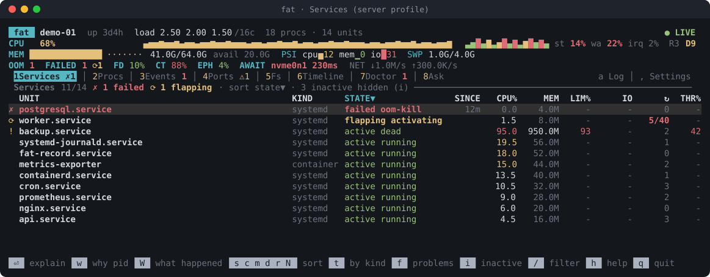
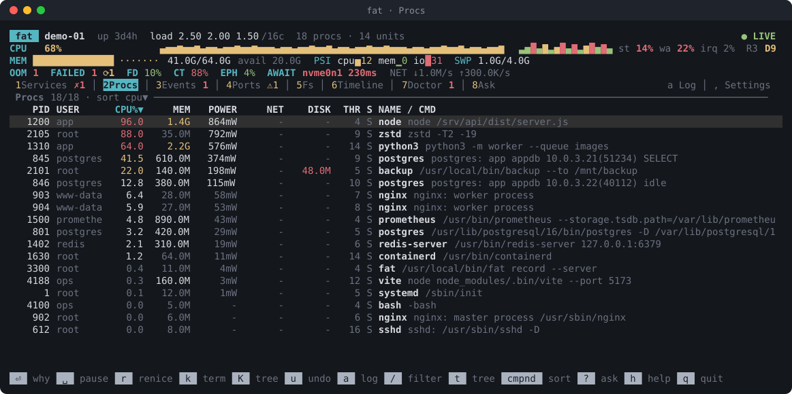
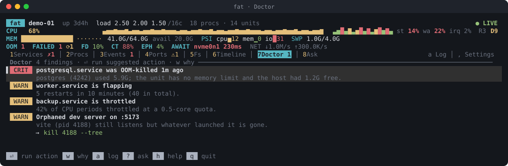
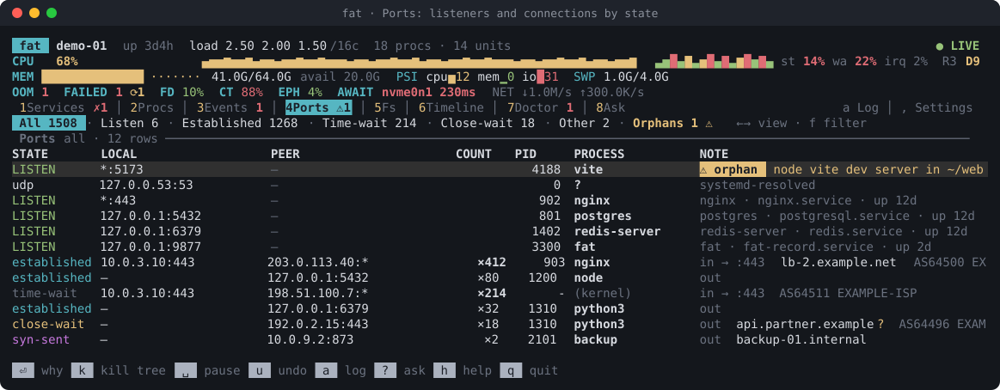
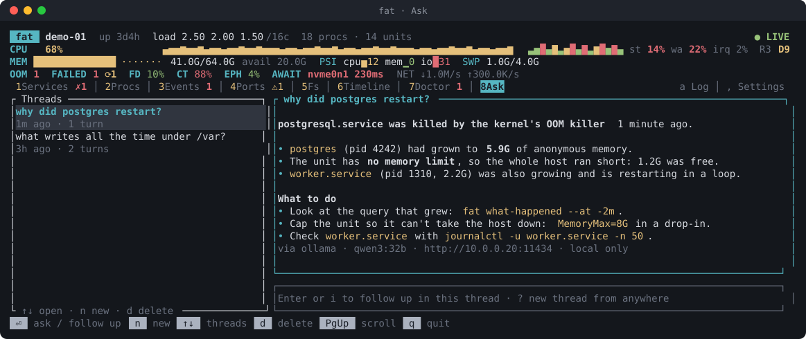
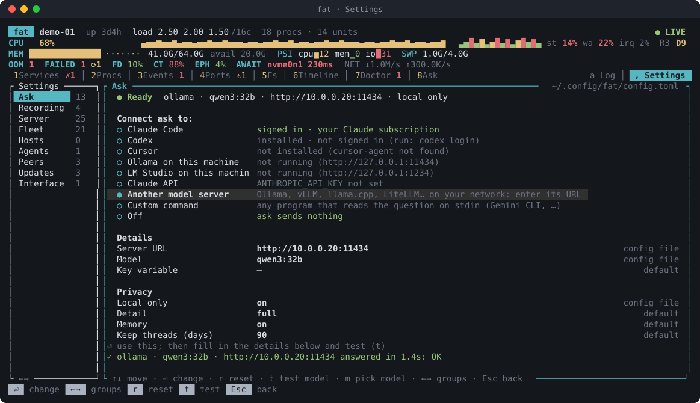

# fat — Freaking Awesome Top

**fat answers "why is this machine slow, hot or full, and what can I safely do about it?"** — for one laptop, one
server, or a whole fleet, for people in a terminal and for AI agents over MCP.



- **See what's wrong, ranked.** `fat doctor` and the Doctor view rank findings (crit, warn, info) and say what to do.
- **Know why a process exists.** `fat why <pid>` shows who started it, since when, and what it costs.
- **Go back in time.** A small flight recorder keeps history, so `fat what-happened --at 03:12` explains an
  incident after the fact.
- **Servers first-class.** systemd units, containers and pods with restarts, OOM kills and throttling; kernel
  health; Prometheus export; read-only fleet view over ssh.
- **Safe actions.** Pause and renice are journaled and can be undone; every action records who asked for it.
- **Ask in plain language.** Ask a language model about the machine (Claude or your own server), with the
  evidence fat collected.

Works on **Linux** (x86_64 and aarch64, static binaries, any distribution) and **macOS** (Apple silicon and Intel).
It never needs `sudo`; root only lets it see more.

## Contents

- [Install](#install)
- [First five minutes](#first-five-minutes)
- [What's in it](#whats-in-it)
- [Documentation](#documentation)
- [License](#license)

## Install

Download a release for your platform from the
[releases page](https://github.com/honzabit/freaking-awesome-top/releases):

| Platform | Archive |
| --- | --- |
| Linux x86_64 (static) | `fat-<version>-x86_64-unknown-linux-musl.tar.gz` |
| Linux aarch64 (static) | `fat-<version>-aarch64-unknown-linux-musl.tar.gz` |
| macOS Apple silicon | `fat-<version>-aarch64-apple-darwin.tar.gz` |
| macOS Intel | `fat-<version>-x86_64-apple-darwin.tar.gz` |

Check the download, then install it:

```bash
sha256sum -c SHA256SUMS --ignore-missing
```

```bash
gh attestation verify fat-<version>-<target>.tar.gz --repo honzabit/freaking-awesome-top
```

```bash
tar -xzf fat-<version>-<target>.tar.gz && install -m 755 fat-<version>-<target>/fat ~/.local/bin/
```

On macOS use `shasum -a 256 -c SHA256SUMS --ignore-missing` for the first step. The attestation proves the archive
was built by this repository's release workflow from that tag.

Later, `fat update` installs new releases after checking their signature; fat also tells you once a day
when there is one. Details: [docs/updates.md](docs/updates.md).

**From source** (Rust 1.89+ and a C compiler; SQLite is bundled):

```bash
cargo install --locked --path .
```

## First five minutes

Open the TUI. Number keys switch views, `h` lists every key, `q` quits:

```bash
fat
```

Ask the machine what's wrong:

```bash
fat doctor
```

Find out why a process exists and what it costs:

```bash
fat why <pid>
```

See what's filling the disk right now:

```bash
fat fs --growth
```

Keep history so you can look back later (see [the flight recorder](docs/recorder.md) to run it always-on):

```bash
fat record
```

Most commands take `--json` for scripts and agents. The full list is in [docs/commands.md](docs/commands.md).

## What's in it

### Processes and the Doctor

The process list is sorted by CPU, with CPU, memory, power and thermal gauges on top. The Doctor ranks what's wrong
and offers a fix you can apply with one key.



- `Enter` explains a process: its blame chain, the evidence, and suggested fixes.
- `space` pauses (undoable), `r` renices, `k` / `K` terminate a process or its tree (asks first, can't be undone).
- `a` opens the action log: everything fat did, who asked for it, and undo.

Details: [docs/tui.md](docs/tui.md).



### Ports and connections

Every listening socket with its owner, plus every TCP connection grouped by state, owner and peer. Orphaned dev
servers (whose terminal or agent is gone) are flagged.



- `←` `→` switch views: All, Listen, Established, Time-wait, Close-wait, Other, Orphans, each with a live count.
- `f` filters by protocol, address scope (loopback, private, public), process, port or range, and peer address.
- A Close-wait count that keeps rising (an application not closing connections) is flagged.

### Storage

What eats your disk, and what's eating it right now: a background scan of usage per directory, plus growth over
the last minutes with the files and processes behind it.

```bash
fat fs /var
```

```bash
fat fs --growth --since 1h --under /var
```

Details: [docs/storage.md](docs/storage.md).

### History and incidents

`fat record` keeps a compact history (roughly 10–30 MB a day, pruned after a few days). With it, the Timeline view and `fat history` travel back in
time, and on servers `fat events` and `fat what-happened` explain incidents as a causal chain.

```bash
fat what-happened --at 03:12
```

Details: [docs/recorder.md](docs/recorder.md).

### Servers and fleets

On headless Linux fat switches to a server profile automatically: the Services view (systemd units, containers,
pods and cgroups), kernel health, events, and Prometheus export from the recorder. Across many hosts, `fat fleet`
polls them read-only over your own ssh config.

```bash
fat services --failed
```

```bash
fat fleet doctor
```

Details: [docs/linux.md](docs/linux.md), [docs/server.md](docs/server.md), [docs/fleet.md](docs/fleet.md).

### Ask

Ask questions in plain language, in the Ask view (`?`) or with `fat ask`. Answers come from a language model, with
fat's evidence attached; follow-ups stay in a thread.



- **An AI tool you're signed in to:** Claude Code, Codex or Cursor, through their own command-line tools and your
  account. No API key needed.
- **Claude API:** set `ANTHROPIC_API_KEY`.
- **Your own model server** (Ollama, LM Studio, vLLM, llama.cpp…), with `local_only` so nothing ever leaves your
  network.
- Press `,` and open **Ask**: it lists what it finds on this machine; pick one and press `t` to test it.
- Without a model, ask sends nothing and says how to set one up.
- Secrets, your home directory and your user name are redacted from every request; `fat ask --dry-run` shows
  exactly what would be sent.

Details: [docs/ask.md](docs/ask.md).

### Settings

`,` opens the Settings screen: every setting with its value and where it comes from (default, config file, or
environment). Changes are written to your config file, keeping its comments.



Details: [docs/tui.md](docs/tui.md#settings-), [docs/configuration.md](docs/configuration.md).

### For agents (MCP)

`fat mcp` runs an MCP server on stdio, so agents can read everything above. Actions that change the machine are
off unless you allow them, and a kill always needs a preview first.

```bash
claude mcp add fat -- fat mcp
```

Details: [docs/agents.md](docs/agents.md).

## Documentation

| Topic | |
| --- | --- |
| Every command | [docs/commands.md](docs/commands.md) |
| The TUI: views, keys, screens | [docs/tui.md](docs/tui.md) |
| Storage: usage and growth | [docs/storage.md](docs/storage.md) |
| The flight recorder, always-on | [docs/recorder.md](docs/recorder.md) |
| Linux: services, kernel health, root vs non-root | [docs/linux.md](docs/linux.md) |
| Servers: system-wide recorder, Prometheus | [docs/server.md](docs/server.md) |
| Fleets over ssh | [docs/fleet.md](docs/fleet.md) |
| Ask, threads, keeping it in your network | [docs/ask.md](docs/ask.md) |
| Agents and MCP | [docs/agents.md](docs/agents.md) |
| Updates: version check, `fat update`, auto-update | [docs/updates.md](docs/updates.md) |
| Configuration reference | [docs/configuration.md](docs/configuration.md) |
| Everything fat does | [docs/features.md](docs/features.md) |
| Design notes, performance, limitations | [docs/design.md](docs/design.md) |
| Releasing | [RELEASING.md](RELEASING.md) |

The screenshots are rendered by fat itself from made-up demo data; `cargo test screenshots -- --ignored`
regenerates them.

## License

MIT. See [LICENSE](LICENSE).
